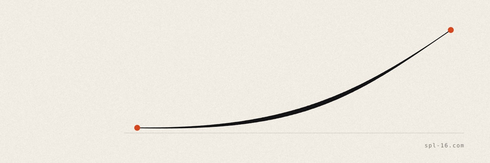
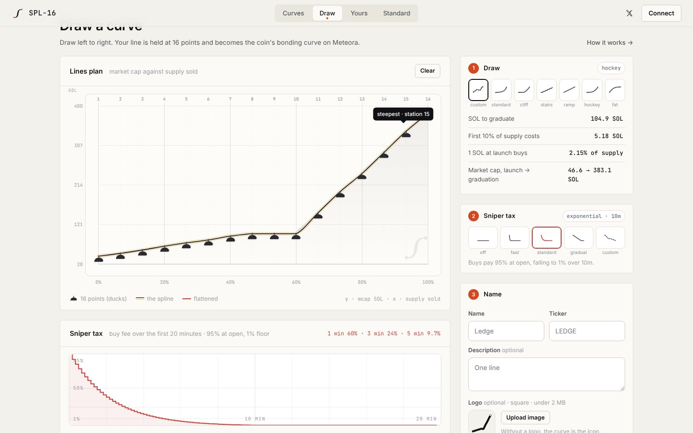

<p align="center"></p>

# SPL-16 · the Spline Standard

**Draw the curve your coin trades on.**

SPL-16 is a Solana launchpad built on [Meteora's Dynamic Bonding Curve](https://docs.meteora.ag/) (DBC). On most launchpads every coin trades on the same curve. Here the creator draws it: the stroke is held at 16 price points, compiled into a **dedicated DBC config for that coin**, and enforced by Meteora's program from the first buy to graduation.

Live at **[spl-16.com](https://spl-16.com)** · [@splsixteen](https://x.com/splsixteen)

<p align="center"></p>

---

## What a creator controls

| | |
|---|---|
| **Price curve** | Any non-decreasing shape across 16 stations, or a preset: `standard` (constant-product, x·y=k), `cliff`, `stairs`, `ramp`, `hockey`, `fat`. |
| **Sniper tax** | Optional buy fee of 95% at open, decaying to 1%. Pick a schedule or draw one; the stroke is fitted to DBC's linear or exponential fee scheduler (1–20 min, 10 s steps). The scheduler can only lower the fee. |
| **Dev buy** | First buy executed in the launch transaction, before the pool is public. |
| **Post-graduation pool fee** | 0.25%, 1%, 2% or 4% on the DAMM v2 pool the coin migrates to. |
| **Volatility fee** | DBC's dynamic fee, on or off. |

Every option is shown on the coin's card and page, so buyers see the rules before they trade.

## How a drawing becomes a pool

```
stroke ──► 16 heights h₁…h₁₆ ∈ [0,1]        (made non-decreasing: price can't fall)
       ──► prices pᵢ = (START + (MAX − START)·hᵢ) / 10⁹      SOL per token
       ──► sqrtPrices (Q64.64)               createSqrtPrices(p, 6, 9)
       ──► liquidity weights                 Lᵢ ∝ 1 / (1/√Pᵢ − 1/√Pᵢ₊₁)
       ──► buildCurveWithCustomSqrtPrices    15 constant-product segments
       ──► createConfigAndPool               signed by the creator's wallet
```

The liquidity weights make every segment sell the same 1/15 of the curve supply, so the x-axis of the drawing really is "share of supply sold". The graduation threshold is the sum of SOL across segments, so it differs per drawing and is written to the config as `migrationQuoteThreshold`.

**Token:** standard SPL token, 1,000,000,000 supply, 6 decimals, mint authority revoked, immutable metadata. The 16 heights are stored in the metadata (`attributes.curve`) along with a rendering of the curve, so any client can redraw the curve from the mint alone.

**Fees:** 1% after the sniper window. 50% to the creator, 50% to the platform (after Meteora's protocol share), claimable straight from the pool.

**Graduation:** at the threshold, the pool migrates to Meteora DAMM v2. LP is permanently locked, split 50/50 between creator and platform.

The full specification, with diagrams, is at [spl-16.com/standard](https://spl-16.com/standard).

## Architecture

```
public/            single-page app: index.html, app.js, app.css (no build step)
server.js          Express API, launch flow, live pool sync loop
lib/curve.js       points → prices → DBC config; quote(); presets; shape classifier
lib/launch.js      builds the unsigned launch transaction(s); partial-signs config + mint keys only
lib/swap.js        builds unsigned buy/sell transactions against a coin's pool; balance checks
lib/live.js        reads pool state, derives trades from on-chain token-balance deltas
lib/meteora.js     shared Solana connection + DBC client
lib/icon.js        a coin's icon is its curve (SVG / PNG)
lib/store.js       metadata + images (local disk or IPFS via Pinata)
lib/db.js          SQLite (better-sqlite3)
```

The server never holds a creator's or trader's key. Launches and trades are built server-side and signed in the user's wallet.

### API

| Method | Path | |
|---|---|---|
| `GET` | `/api/state` | coins + platform totals |
| `POST` | `/api/quote` | quote a drawing: threshold, cost of first 10%, mcap range, detected shape |
| `POST` | `/api/launch/prepare` | build the launch transaction(s) for a drawing |
| `POST` | `/api/launch/confirm` | confirm a launch signature and list the coin |
| `GET` | `/api/coin/:mint/live` | fresh pool read, price history, recent trades |
| `POST` | `/api/swap` | build an unsigned buy/sell for a wallet |
| `GET` | `/api/balance/:mint/:wallet` | SOL + token balance |

## Run locally

Requires Node 22+.

```bash
npm install
cp .env.example .env      # set HOUSE_WALLET and an RPC (HELIUS_API_KEY or SOLANA_RPC_URL)
DRY_RUN=1 npm run dev     # http://localhost:8792 — launches are simulated, nothing touches the chain
```

## Deploy

`render.yaml` is a Render blueprint (web service + persistent disk at `/data`). Set `SITE_URL`, `HOUSE_WALLET` and `HELIUS_API_KEY`; optionally `PINATA_JWT` / `PINATA_GATEWAY` with `ASSET_STORE=pinata` to pin metadata and images to IPFS.

## License

MIT
